<h1 align="center">Control de Mobiliario · Frontend</h1>

<div align="center"></div>

<p align="center">
  
  
  
</p>

## Descripción

- Aplicación web para el personal encargado de la renta y el préstamo de mobiliario para eventos. Está pensada para usarse principalmente desde el móvil, aunque se adapta a escritorio.
- El proyecto se divide en dos partes, frontend y backend. Este repositorio contiene el **frontend**.
- El backend (API REST con Spring Boot) está en: https://github.com/arcan16/ControlMobiliarioBackend

## Tecnologías utilizadas

<div align="center">


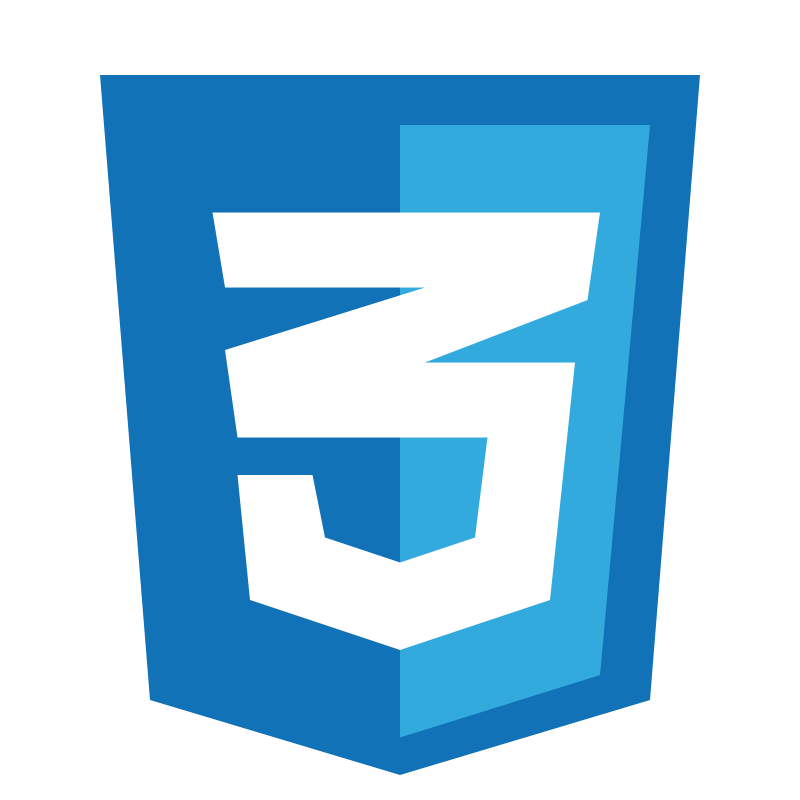
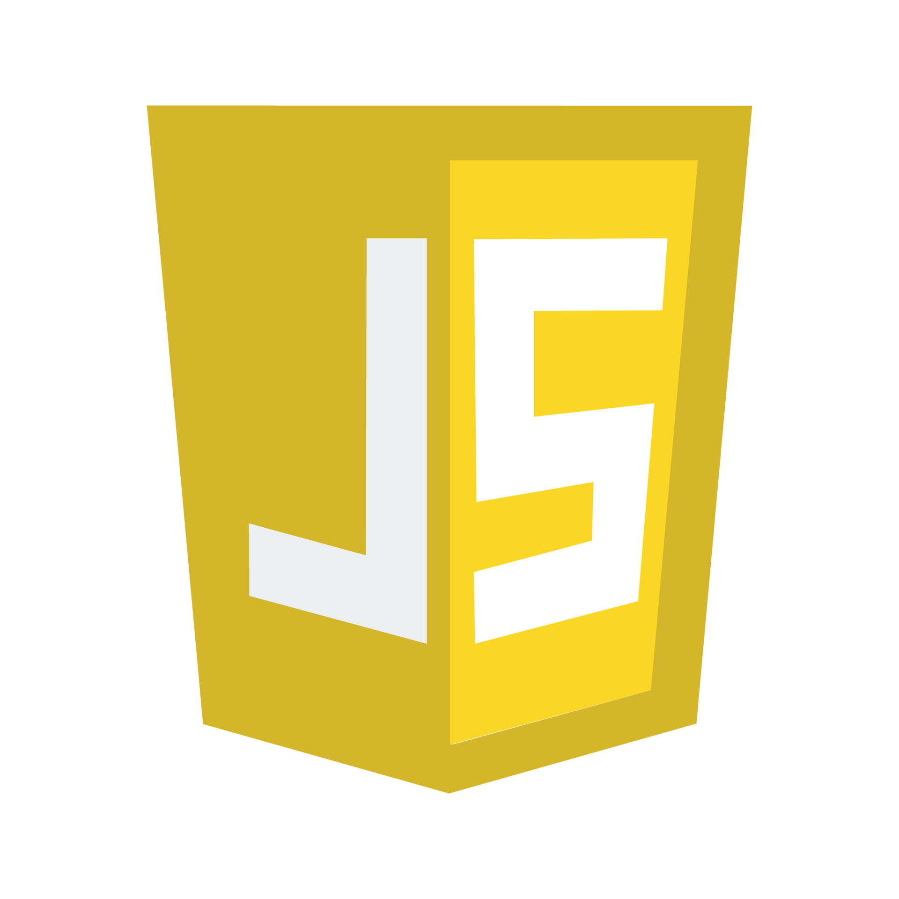
</div>

- **React 18** con **Vite 5**
- **Redux** y **React Redux** para el estado global
- **React Router 6** para la navegación
- **js-cookie** para la sesión del usuario
- **CSS** propio con variables de diseño (sin frameworks de estilos)
- **ESLint** para el análisis del código

## Funciones

- Inicio de sesión con token JWT
- Recuperación de contraseña por correo electrónico
- Panel principal con resumen de pendientes: préstamos activos, reservaciones vigentes, entregas y recepciones del día e inventario
- Alta, edición y eliminación de:
  - Usuarios
  - Empleados
  - Clientes
  - Tipos de mobiliario
  - Mobiliario
  - Presentaciones
  - Reservaciones
  - Cobros
- Agenda de reservaciones con filtros por estado y por periodo
- Historial de cobros realizados
- Búsqueda de registros por nombre, código o fecha, según el tipo de registro

## Interfaz

En 2026 la interfaz se rediseñó para darle un aspecto más moderno y consistente:

- Colores basados en el logo de Mobi Eventos (ciruela y magenta) y tipografía [Plus Jakarta Sans](https://fonts.google.com/specimen/Plus+Jakarta+Sans).
- Barra de navegación fija con la sección activa resaltada y menú desplegable en el móvil.
- Tarjetas, tablas, botones, formularios y ventanas modales con un mismo estilo.
- Diseño adaptable: en pantallas pequeñas los formularios pasan a una columna y las tablas se desplazan horizontalmente.

Todos los estilos están en `src/App.css`. Los colores, radios y sombras se definen como variables al inicio del archivo (`:root`), así que para cambiar la paleta basta con editar esos valores.

<table>
  <tr>
    <td>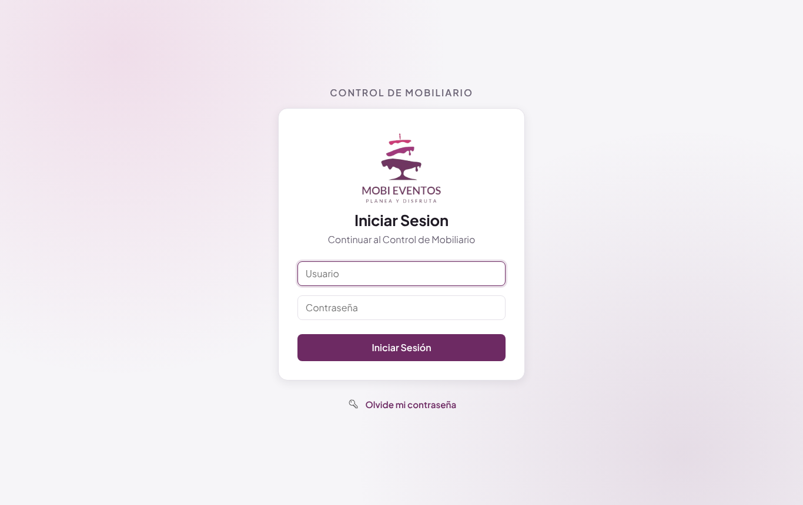</td>
    <td>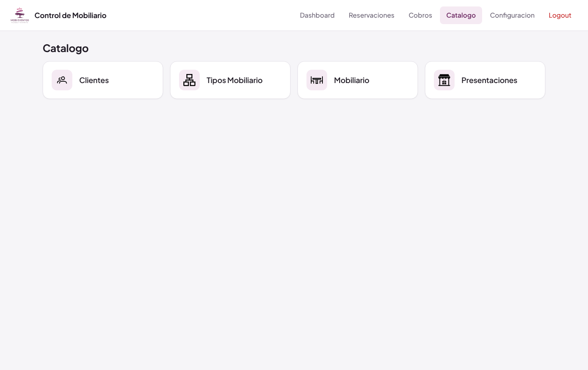</td>
  </tr>
  <tr>
    <td>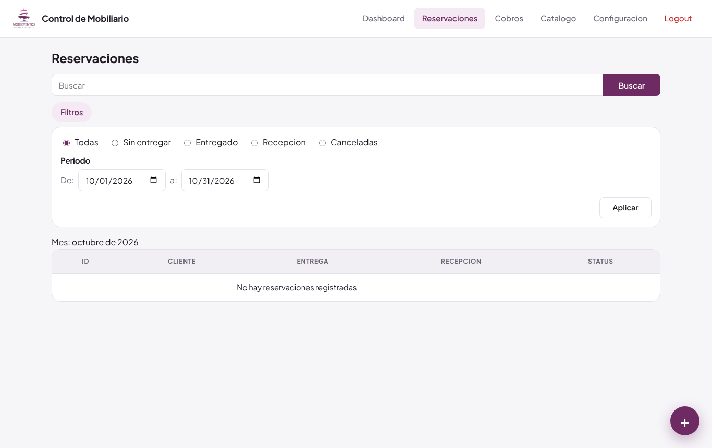</td>
    <td align="center">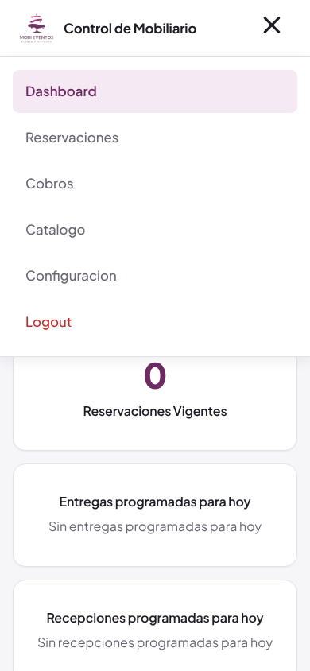</td>
  </tr>
</table>

## Requisitos

- [Node.js](https://nodejs.org/) 18 o superior (incluye npm)
- El [backend](https://github.com/arcan16/ControlMobiliarioBackend) en ejecución, con Java y MySQL

## Cómo ejecutar el proyecto en desarrollo

1. Clona y levanta el backend siguiendo las instrucciones de su repositorio: https://github.com/arcan16/ControlMobiliarioBackend
2. Clona este repositorio en otra carpeta:
   ```bash
   git clone https://github.com/arcan16/ControlMobiliarioFrontend.git
   cd ControlMobiliarioFrontend
   ```
3. Indica la dirección del backend en `src/helpers/helpHost.js`. La función `getIp()` devuelve la IP del equipo donde corre la API (por ejemplo `localhost`); el frontend se conecta al puerto `8080`.
4. Instala las dependencias y arranca el servidor de desarrollo:
   ```bash
   npm install
   npm run dev
   ```
5. Abre en el navegador la dirección que muestra la terminal (por defecto http://localhost:5173).

### Otros comandos

| Comando | Descripción |
|---|---|
| `npm run build` | Genera la versión de producción en la carpeta `dist/` |
| `npm run preview` | Sirve localmente la versión de producción |
| `npm run lint` | Revisa el código con ESLint |

### Primer inicio de sesión

El usuario administrador inicial lo crea el backend la primera vez que se ejecuta. Su nombre y contraseña se definen en las variables de entorno `ADMIN_USERNAME` (por defecto `admin`) y `ADMIN_PASSWORD`; consulta el `.env.example` del backend.

## Estructura del proyecto

```
src/
├── App.jsx           # Rutas y control de sesión
├── App.css           # Estilos y variables de diseño
├── pages/            # Pantallas principales (login, dashboard, reservaciones, catálogo, configuración)
├── components/       # Componentes por módulo (clientes, mobiliario, cobros, usuarios, etc.)
├── helpers/          # Peticiones HTTP (helpHttp) y dirección del backend (helpHost)
├── actions/, reducers/, store/, types/   # Estado global con Redux
└── assets/           # Logos e íconos
```

## Capturas del proyecto

> Las animaciones de esta sección corresponden a la versión anterior de la interfaz y muestran el funcionamiento de cada módulo.

#### Inicio de sesión y reservación
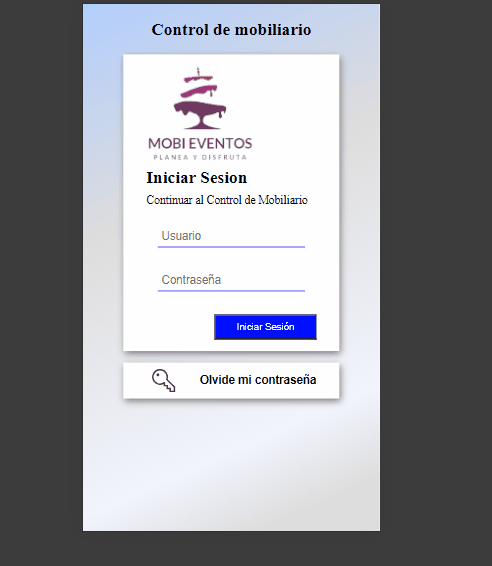

#### Reservaciones activas
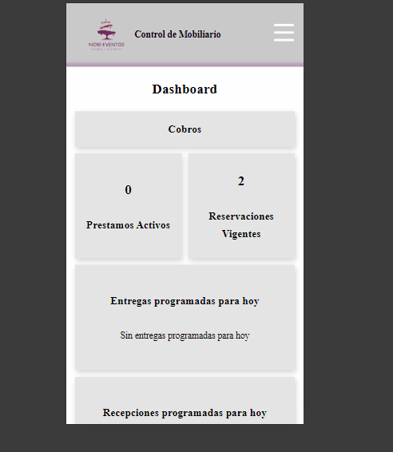

#### Realización de un cobro
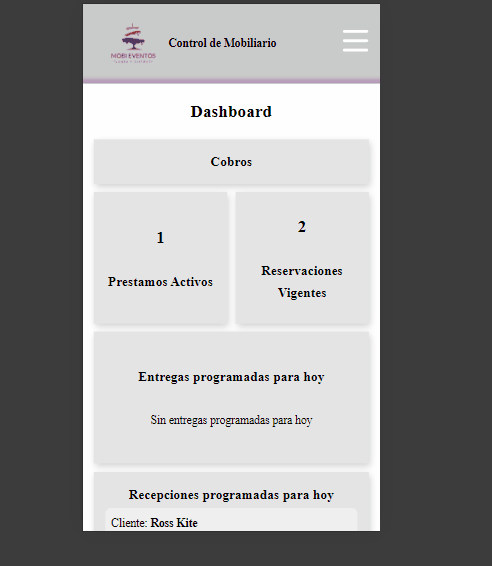

#### Alta, modificación y eliminación de registros
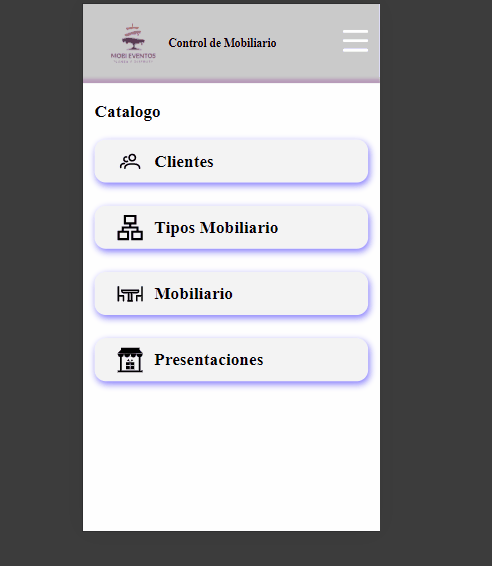
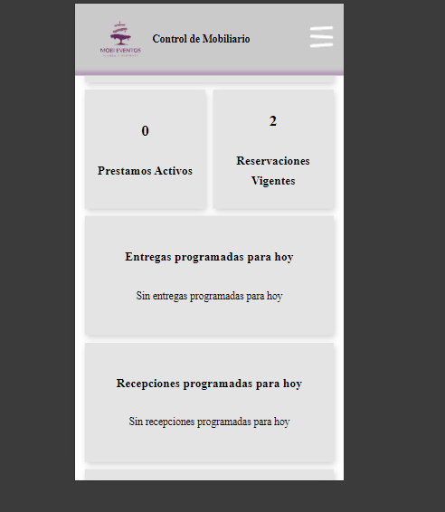


#### Inventario
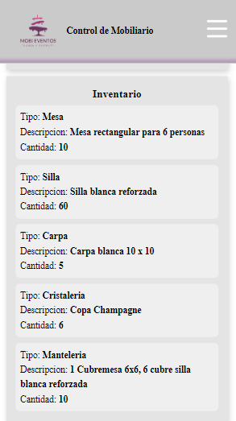

#### Recuperación de contraseña
1. Presiona "Olvidé mi contraseña".

   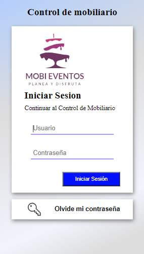
2. Escribe tu usuario o correo electrónico.

   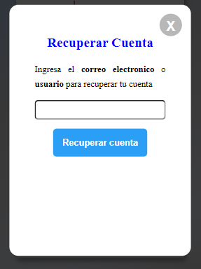
   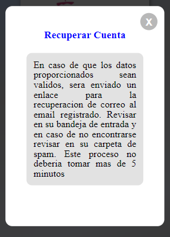
3. Recibirás un enlace en tu correo para actualizar la contraseña.

   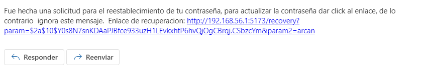
4. Escribe la nueva contraseña y listo.

   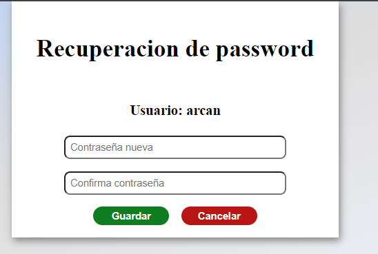

<h2 align="center">Búscame en mis redes</h2>

<p align="center">
  <a href="https://www.linkedin.com/in/sergioparedesarellano"></a>
  <a href="https://github.com/arcan16"></a>
</p>
